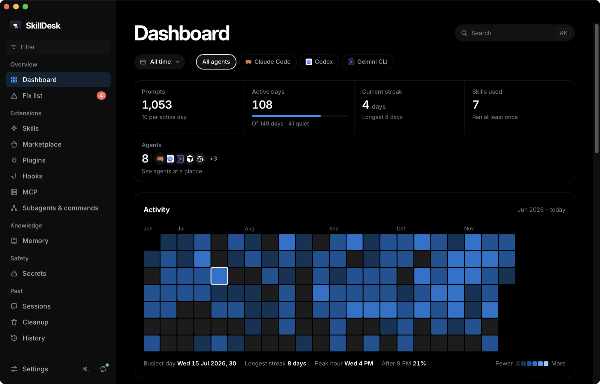

<div align="center">


# SkillDesk

**See everything your coding agents know and keep, then fix what's broken.**

One Mac app for the skills, plugins, hooks, MCP servers, memory, sessions, and secrets of Claude Code, Cursor, Codex, OpenCode, Gemini CLI, GitHub Copilot, and 50 more agents.

[](https://github.com/kushalBanda/skilldesk/actions/workflows/ci.yml)
[](https://github.com/kushalBanda/skilldesk/releases/latest)
[](LICENSE)


[Download](https://github.com/kushalBanda/skilldesk/releases/latest) · [What it finds](#what-it-finds) · [Privacy](#privacy-and-safety) · [CLI](#command-line-tool) · [Contributing](CONTRIBUTING.md)

</div>

<p align="center">
  
</p>

---

You installed a skill for Claude Code in March. A hook in June. Three MCP servers for Cursor, two of which you tried once. Codex has its own skills folder now, and so does Gemini CLI. Somewhere in six months of session history there's an API key you pasted into a prompt.

Each agent shows you its own corner, if it shows you anything. SkillDesk reads the real files of every agent on your Mac and puts them in one place. Every number links to the file and line it came from. Every change it makes goes to the Trash first and has an Undo.

## What it finds

**Dashboard.** Totals across every agent, what changed since the last scan, and the fixes that matter most.

**Fix list.** A ranked list of problems, each with the evidence and a one-click fix:

| Problem | What SkillDesk checks |
| --- | --- |
| Broken hooks | Hooks that fail on every run, or call a script that's gone |
| Slow hooks | Hooks that cost you minutes, measured from their real run times (p95) |
| Dangling skill links | Links in an agent's skills folder that point at nothing |
| Skills that never ran | Claude Code skills that never ran, per Claude's own usage counts |
| Ghost plugins | Plugins you used often that are no longer installed |
| Unused marketplaces | Plugin marketplaces that supply nothing you use, and the disk they take |
| Silent MCP servers | MCP servers never called, though each adds its tools to every prompt |
| Duplicate memories | The same rule saved in several projects, ready to merge into one global rule |
| Secrets in history | API keys and tokens sitting in session transcripts |
| Reclaimable disk | Old caches, logs, and sessions you can safely move to the Trash |

**Extensions.** Skills, plugins, hooks, MCP servers, subagents, and slash commands for every agent, side by side. See which agent has which skill, and link a skill into another agent's folder with one click.

**Marketplace.** Search [skills.sh](https://skills.sh) and GitHub, read a skill before you install it, and install it into the agents you pick.

**Memory.** Every `CLAUDE.md`, `AGENTS.md`, `GEMINI.md`, and rules file your agents load, in one list.

**Secrets.** Private keys, plus Anthropic, OpenAI, Stripe, AWS, GitHub, Slack, and Google keys, JWTs, and database URLs found in agent history. Values stay masked. Touch ID reveals one; Redact replaces it in every file that holds it.

**Sessions.** Search past prompts across every agent, then resume a session or open its project.

**Cleanup.** Disk use by agent, and what can go to the Trash.

**History.** Every change SkillDesk made, newest first, each with Undo.

**Menu bar.** The fix count and the top three fixes, without opening the window.

## Supported agents

**Full support** (skills, plugins, hooks, MCP servers, subagents, commands, memory, sessions, and secrets):

| Agent | Reads |
| --- | --- |
| Claude Code | `~/.claude`, `~/.claude.json` |
| Cursor | `~/.cursor`, Cursor's `state.vscdb` (read-only) |
| Codex | `~/.codex` |
| OpenCode | `~/.config/opencode`, `~/.local/share/opencode` |
| Gemini CLI | `~/.gemini` |
| GitHub Copilot CLI | `~/.copilot` |

Plus the shared `~/.agents/skills` folder that several agents read.

<details>
<summary><b>Skills support</b> for 50 more agents: detect, list, and link skills</summary>

<br>

Amp, Antigravity, AdaL, Augment, AutoClaw, Cline, CodeBuddy, Command Code, Continue, Cortex Code, Crush, DeepSeek Harness, Deep Agents, Droid, EasyClaw, Firebender, GitLab Duo, Goose, Grok, Hermes Agent, IBM Bob, iFlow CLI, Junie, Kilo Code, Kimi Code CLI, Kiro CLI, Kode, MCPJam, MiniMax Code, Mistral Vibe, Mux, Neovate, OMP Agent, OpenClaw, OpenHands, Pi, Pochi, QClaw, Qoder, Qwen Code, Replit, Roo Code, TRAE CN, TRAE IDE, Warp, Windsurf, WorkBuddy, WorkBuddy AI, ZCode, Zencoder.

</details>

Using an agent that isn't listed? Add it in **Settings > Custom agents** by pointing at its skills folder, or [ask for it](https://github.com/kushalBanda/skilldesk/issues/new?template=feature_request.yml).

## Install

Requires macOS 12 or later, on Apple silicon or Intel.

1. Download `SkillDesk_<version>_universal.dmg` from the [latest release](https://github.com/kushalBanda/skilldesk/releases/latest).
2. Open it and drag SkillDesk to Applications.
3. Open SkillDesk. The first scan takes about two minutes. Secrets and Cursor's database keep scanning in the background.

> [!NOTE]
> Until SkillDesk is notarized by Apple, macOS may say the app "is damaged" or "can't be opened". It isn't damaged; it's unsigned. Clear the download flag once, then open it as usual:
>
> ```sh
> xattr -cr /Applications/SkillDesk.app
> ```

SkillDesk updates itself. It checks GitHub Releases on launch, shows a dot on Settings when a version is ready, and installs it when you click **Install and restart**. Each update is signed, and the app refuses one that doesn't verify.

### Build from source

You need [Rust](https://rustup.rs) 1.89+ and Node 22.

```sh
git clone https://github.com/kushalBanda/skilldesk.git
cd skilldesk
npm ci
npm run app:build
```

The app lands in `target/release/bundle/macos/SkillDesk.app`. See [CONTRIBUTING.md](CONTRIBUTING.md) for the dev setup.

## Command-line tool

The app carries a `skilldesk` command that uses the same core and database. Install it from **Settings > Command-line tool**; it goes to `~/.local/bin/skilldesk`.

```sh
skilldesk scan                    # scan every agent and refresh the cache
skilldesk fixes                   # the ranked Fix list
skilldesk list skill              # every skill, with the agents that load it
skilldesk sessions "rate limit"   # past prompts that mention "rate limit"
skilldesk secrets                 # secrets found in history, masked
skilldesk storage                 # disk use by agent
skilldesk agents --all            # every agent SkillDesk knows, found or not
```

Commands that change files show the plan and stop. Add `--yes` to apply:

```sh
skilldesk link pdf-tools cursor          # shows what it would copy
skilldesk link pdf-tools cursor --yes    # copies it into ~/.cursor/skills
skilldesk history                        # the change, with its id
skilldesk undo <id> --yes                # puts it back
```

Every command takes `--json`, so you can pipe SkillDesk into `jq`, a script, or another agent.

## Privacy and safety

SkillDesk reads files that hold your prompts, settings, and credentials. Here's what it does with them.

- **No telemetry, no account.** Nothing about your Mac or your files leaves it.
- **Two kinds of network use, both visible.** The Marketplace talks to skills.sh and GitHub when you open it. The updater asks GitHub Releases for a newer version once per launch; turn that off in **Settings > App updates**. Scans never touch the network. CI checks that only the Marketplace code and the updater can use the network.
- **Secrets stay masked.** SkillDesk stores a salted hash and the known prefix of each secret, never the value. Seeing a full value takes Touch ID or your password.
- **Agent databases are read-only.** Cursor's `state.vscdb` and other agent stores open read-only and immutable. SkillDesk never writes them, never locks them.
- **Every change is a plan first.** You see exactly which files change before anything happens. Replaced or removed files go to the Trash or a backup, and History keeps an Undo for each change.
- **The UI never touches files.** The window can only call the Rust core, which owns every read and write.

SkillDesk keeps its own cache and History in `~/Library/Application Support/SkillDesk`. Delete that folder to reset it.

Found a security problem? See [SECURITY.md](SECURITY.md).

## FAQ

**Does SkillDesk change my agents' config on its own?**
No. It reads on its own and writes only when you click a fix, link, install, or cleanup action. Each one shows its plan first.

**Will it slow down my agents?**
No. SkillDesk watches agent folders for changes and rescans in the background. It never runs inside an agent.

**Does it work on Linux or Windows?**
Not yet. The core is plain Rust, but agent paths, the Trash, and Touch ID are macOS-specific today.

**Why can't it show costs in dollars?**
Agents don't record prices reliably in local files, and a wrong number is worse than none. SkillDesk shows hook time and disk use instead, which it can measure.

## Built with

[Tauri 2](https://tauri.app), Rust, SQLite, React 19, TanStack Query, and Tailwind CSS 4.

```
crates/core   every scan, parser, rule, and write; no UI types
crates/cli    the skilldesk command
src-tauri     the app shell, tray, and window
src           the React UI
```

## Contributing

Bug reports, agent requests, and pull requests are welcome. Start with [CONTRIBUTING.md](CONTRIBUTING.md). Please follow the [code of conduct](CODE_OF_CONDUCT.md).

## License

[MIT](LICENSE) © 2026 Kushal Banda
