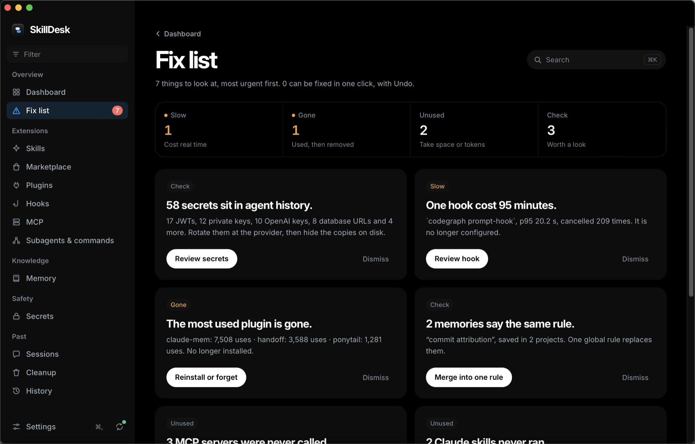
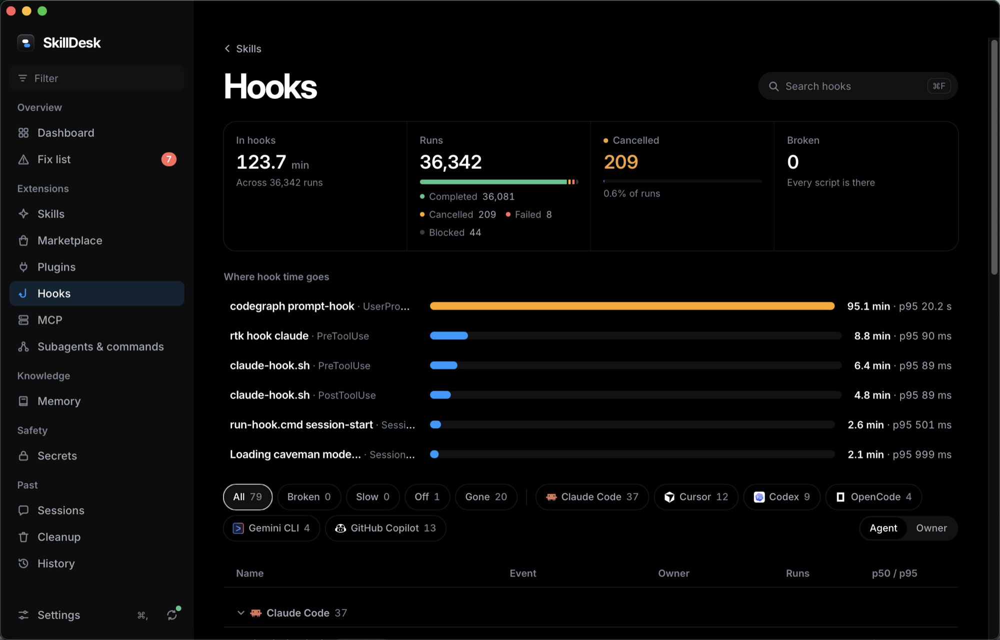
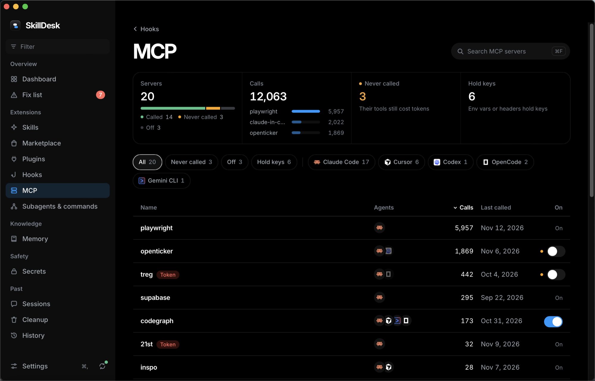

<div align="center">


# SkillDesk

**Everything your coding agents know and keep, in one place.**

A Mac app that reads the skills, plugins, hooks, MCP servers, memory, sessions, and secrets of every coding agent you use, then shows you what to fix.

[](https://github.com/kushalBanda/skilldesk/actions/workflows/ci.yml)
[](https://github.com/kushalBanda/skilldesk/releases/latest)
[](LICENSE)


**[Download for macOS](https://github.com/kushalBanda/skilldesk/releases/latest)**

[Features](#features) · [Agents](#supported-agents) · [Install](#install) · [CLI](#command-line-tool) · [Privacy](#privacy-and-safety)

<br>


</div>

## Why

Each agent keeps its own skills folder, hooks file, MCP config, and session history, and shows you little of it. After a few months you have skills nothing loads, hooks that quietly cost minutes a day, MCP servers you tried once, and an API key pasted into a prompt.

SkillDesk reads the real files of every agent on your Mac and puts them in one place. Every number opens the items behind it. Every change goes to the Trash or a backup first, with Undo.

## Features

### Fix list



A ranked list of problems, each with its evidence and a fix:

| Problem | How SkillDesk finds it |
| --- | --- |
| Broken hooks | Fail on every run, or call a script that's gone |
| Slow hooks | Total time and p95 from real run logs |
| Dangling skill links | Links in a skills folder that point at nothing |
| Skills that never ran | Claude Code's own usage counts |
| Ghost plugins | Used often, no longer installed |
| Unused marketplaces | Supply nothing you use, still take disk |
| Silent MCP servers | Never called, yet their tools load into every prompt |
| Duplicate memories | Same rule saved in several projects |
| Secrets in history | API keys and tokens in session transcripts |
| Reclaimable disk | Old caches, logs, and sessions |

### Hooks and MCP servers

<table>
<tr>
<td width="50%"></td>
<td width="50%"></td>
</tr>
<tr>
<td>See where hook time goes, per hook and per agent, and turn hooks off with Undo.</td>
<td>Calls and last use per server, which ones hold keys, and an on/off switch per agent.</td>
</tr>
</table>

### And the rest

- **Skills.** Every skill across every agent, which agents load it, and how often it ran. Link a skill into another agent in one click.
- **Plugins.** Installed plugins, marketplaces, and old cache versions.
- **Subagents and commands.** Side by side for every agent.
- **Marketplace.** Search [skills.sh](https://skills.sh) and GitHub, read a skill, install it into the agents you pick.
- **Memory.** Every `CLAUDE.md`, `AGENTS.md`, `GEMINI.md`, and rules file your agents load.
- **Secrets.** Private keys, Anthropic, OpenAI, Stripe, AWS, GitHub, Slack, and Google keys, JWTs, and database URLs. Masked; Touch ID reveals one; Redact removes it from the text files that hold it.
- **Sessions.** Search past prompts across agents and resume a session.
- **Cleanup.** Disk use by agent, and what can go to the Trash.
- **History.** Every change SkillDesk made, each with Undo.
- **Menu bar.** The fix count and top fixes without opening the window.
- **⌘K.** Jump to any screen, item, or action.

## Supported agents

**Full support**: skills, plugins, hooks, MCP servers, subagents, commands, memory, sessions, and secrets.

| Agent | Reads |
| --- | --- |
| Claude Code | `~/.claude`, `~/.claude.json` |
| Cursor | `~/.cursor`, `state.vscdb` (read-only) |
| Codex | `~/.codex` |
| OpenCode | `~/.config/opencode`, `~/.local/share/opencode` |
| Gemini CLI | `~/.gemini` |
| GitHub Copilot CLI | `~/.copilot` |

Plus the shared `~/.agents/skills` folder.

<details>
<summary><b>Skills support for 50 more agents</b>: detect, list, and link skills</summary>

<br>

Amp, Antigravity, AdaL, Augment, AutoClaw, Cline, CodeBuddy, Command Code, Continue, Cortex Code, Crush, DeepSeek Harness, Deep Agents, Droid, EasyClaw, Firebender, GitLab Duo, Goose, Grok, Hermes Agent, IBM Bob, iFlow CLI, Junie, Kilo Code, Kimi Code CLI, Kiro CLI, Kode, MCPJam, MiniMax Code, Mistral Vibe, Mux, Neovate, OMP Agent, OpenClaw, OpenHands, Pi, Pochi, QClaw, Qoder, Qwen Code, Replit, Roo Code, TRAE CN, TRAE IDE, Warp, Windsurf, WorkBuddy, WorkBuddy AI, ZCode, Zencoder.

</details>

Agent missing? Add it in **Settings > Custom agents** by pointing at its skills folder, or [request it](https://github.com/kushalBanda/skilldesk/issues/new?template=feature_request.yml).

## Install

macOS 12 or later, Apple silicon or Intel.

1. Download `SkillDesk_<version>_universal.dmg` from the [latest release](https://github.com/kushalBanda/skilldesk/releases/latest).
2. Drag SkillDesk to Applications and open it.
3. The first scan takes about two minutes. Secrets and Cursor's database finish in the background.

> [!NOTE]
> Until SkillDesk is notarized by Apple, macOS may say the app "is damaged". It's unsigned, not damaged. Clear the download flag once:
>
> ```sh
> xattr -cr /Applications/SkillDesk.app
> ```

SkillDesk updates itself from GitHub Releases. Updates are signed, and the app refuses one that doesn't verify.

<details>
<summary><b>Build from source</b></summary>

<br>

Needs [Rust](https://rustup.rs) 1.89+ and Node 22.

```sh
git clone https://github.com/kushalBanda/skilldesk.git
cd skilldesk
npm ci
npm run app:build
```

The app lands in `target/release/bundle/macos/SkillDesk.app`. Dev setup is in [CONTRIBUTING.md](CONTRIBUTING.md).

</details>

## Command-line tool

The app ships a `skilldesk` command on the same core and database. Install it from **Settings > Command-line tool** (to `~/.local/bin`).

```sh
skilldesk scan                    # scan every agent
skilldesk fixes                   # the ranked Fix list
skilldesk list skill              # every skill and the agents that load it
skilldesk sessions "rate limit"   # search past prompts
skilldesk secrets                 # secrets in history, masked
skilldesk storage                 # disk use by agent
```

Commands that change files print the plan and stop. Add `--yes` to apply:

```sh
skilldesk link pdf-tools cursor --yes
skilldesk history
skilldesk undo <id> --yes
```

Every command takes `--json`, for `jq`, scripts, or another agent.

## Privacy and safety

SkillDesk reads files that hold your prompts, settings, and credentials. Here is what it does with them.

- **No telemetry, no account.** Nothing about your files leaves your Mac.
- **Network only where you see it.** The Marketplace talks to skills.sh and GitHub. The updater checks GitHub Releases once per launch and can be turned off. Scans never use the network, and CI enforces it.
- **Secrets stay masked.** SkillDesk stores a salted hash and the known prefix, never the value. Revealing one takes Touch ID or your password.
- **Agent databases are read-only.** Cursor's `state.vscdb` and other stores are opened read-only and never locked.
- **Plan first, Undo after.** You see which files change before anything happens. Removed files go to the Trash or a backup, and History keeps an Undo.
- **The UI never touches files.** Only the Rust core reads and writes.

App data lives in `~/Library/Application Support/SkillDesk`. Delete it to reset. Security reports: [SECURITY.md](SECURITY.md).

## FAQ

**Does it change my agents' config on its own?**
No. It writes only when you click a fix, link, install, or cleanup, and shows the plan first.

**Does it slow my agents down?**
No. It watches agent folders and rescans in the background. It never runs inside an agent.

**Linux or Windows?**
Not yet. The core is plain Rust, but agent paths, the Trash, and Touch ID are macOS-specific.

**Why no costs in dollars?**
Agents don't record prices reliably in local files. SkillDesk shows what it can measure: hook time and disk use.

## Built with

[Tauri 2](https://tauri.app), Rust, SQLite, React 19, TanStack Query, and Tailwind CSS 4.

```
crates/core   scans, parsers, rules, and every write
crates/cli    the skilldesk command
src-tauri     app shell, tray, and window
src           React UI
```

## Contributing

Bug reports, agent requests, and pull requests are welcome. Start with [CONTRIBUTING.md](CONTRIBUTING.md) and the [code of conduct](CODE_OF_CONDUCT.md).

## License

[MIT](LICENSE) © 2026 Kushal Banda
